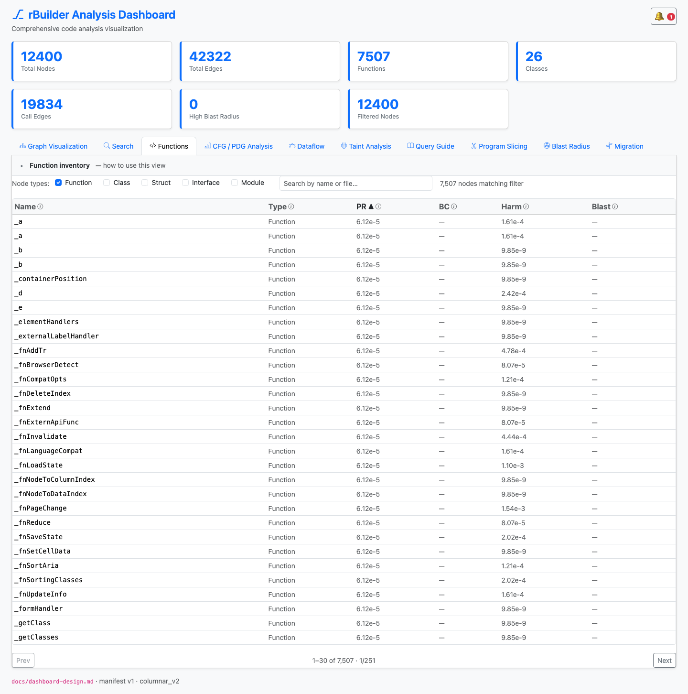
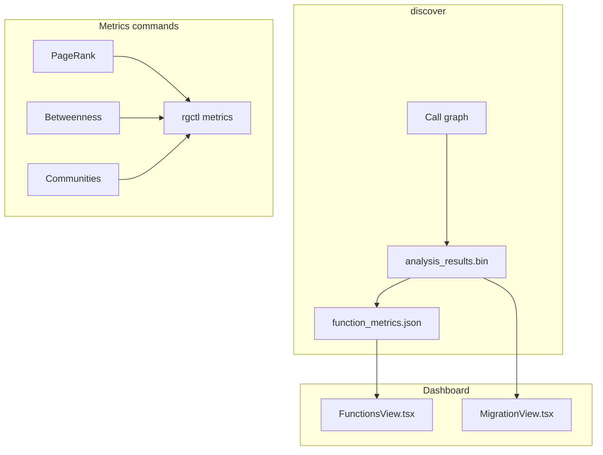

# Graph Metrics — Engineering Design

**Network analytics** on the live call graph: PageRank, betweenness centrality, and community detection — computed at `discover` and surfaced in the **Functions** tab and migration planner.



*Figure 1: **Functions** tab — sortable PageRank (PR), betweenness (BC), harmonic (Harm), and blast columns over the full function inventory.*

---

## 1. Goals

| Goal | How |
|------|-----|
| Find architectural hotspots | Pull-based CSR `FastPageRank` + `SampledBetweenness` on call graph |
| Migration batching | Fast-Leiden communities + harmonic centrality |
| Agent ranking | `-f json metrics --pagerank` |
| Dashboard sort/filter | WASM-paginated function table |

---

## 2. Architecture overview



---

## 3. Metrics reference

| Metric | Meaning | Used in |
|--------|---------|---------|
| **PageRank** | Global importance (`FastPageRank`, dual-track Calls vs structural; default `NodeRole::Production` hotspots) | Functions tab, migration α term |
| **Betweenness** | Bridge / bottleneck (`SampledBetweenness`, $K=256$) | Functions tab, policy cascade hazard |
| **Harmonic** | Reachability closeness (`HyperBallHarmonic`, `--with-harmonic`) | Functions tab, migration β term |
| **Communities** | Fast-Leiden clusters (+ $\mu+4\sigma$ hub strip) | Graph colors, migration community vote |
| **Blast score** | Precomputed impact (per function) | Functions tab, migration γ term |
| **Git churn** | Recency-weighted hotspot + `CoChangesWith` (after `discover --with-git`) | `metrics --churn` |

Background: [harmonic-centrality.md](../harmonic-centrality.md), [migration-algorithms.md](../migration-algorithms.md), [internal/profile.md](../internal/profile.md) (cold-profile corpora and timings).

---

## 3.2 Large-graph behavior (≥ 50k nodes)

Discover applies **adaptive centrality gating** and a **columnar write path** so kernel-scale repos stay within memory and time budgets.

| Concern | Behavior |
|---------|----------|
| Centrality storage | Flat `Vec` → `AnalysisResults::CentralityTable` (no UUID `HashMap` on discover) |
| `FastPageRank` (V > 500k) | 8 iterations, ε=1e-4; dual-track Calls vs `STRUCTURAL_EDGE_TYPES`; default hotspots filter `NodeRole::Production` |
| HyperBall harmonic (V > 500k) | 8 rounds, **Rayon-parallel** node scatter |
| `SampledBetweenness` | $K=256$ degree-stratified Brandes pivots (exact Brandes when V small) |
| `function_metrics.json` | **`sparse_mode: "community_only"`** — empty rows; use WASM + metagraph |
| `metagraph.json` | Package-level aggregates only (`member_indices` omitted at scale) |
| Dashboard export | In-memory `AnalysisResults` via `DashboardExportContext` (no reload per stage) |

**Profiling:** `RUST_LOG=profile=info rgctl discover . -v` → `[profile] centrality sub-phase` lines.

**CLI precision:** `rgctl metrics --pagerank --iterations N` still honors explicit iteration counts on demand.

---

## 3.1 Community detection naming

**What ships:** **Fast-Leiden** on CSR `FlatGraphIndex` ([Traag, Waltman & van Eck, 2019](https://doi.org/10.1038/s41598-019-41695-z)) — not Raghavan label propagation and not the classic Louvain library. Pipeline:

0. **$\mu + 4\sigma$ `HubStripPolicy`** — isolate ubiquitous utilities into `"Shared / Infrastructure"` (`infrastructure_community_id`)
1. **Queue-based local moving** — modularity gain $\Delta Q$ with deterministic tie-breaking
2. **BFS connected-subgraph refinement** (`refine_partition`) — guarantees 0 disconnected communities
3. **Super-node coarsening** — aggregate and repeat until modularity converges

| Name in repo | What it actually is |
|--------------|---------------------|
| `CommunityDetector` | Fast-Leiden on `Calls` + `Uses` (+ `References` when present) |
| `community_id` | Majority vote of Fast-Leiden ids on package macro / metagraph nodes (migration_graph schema v3; older sidecars may still use `louvain_community_id`) |
| Label propagation (Raghavan) | **Not** what ships (superseded by Fast-Leiden) |

Implementation: [`crates/rgctl-analysis/src/community.rs`](../../crates/rgctl-analysis/src/community.rs). For migration batching, the dashboard uses **package/module macro nodes**; community ids mainly drive graph coloring and cluster-aware layout, not the primary schedule order.

---

## 4. Rust implementation map

| Component | Path |
|-----------|------|
| Centrality | `crates/rgctl-analysis/src/centrality.rs` (`FastPageRank`, `NodeRole`), `centrality_approx.rs` (`SampledBetweenness`) |
| Communities | `crates/rgctl-analysis/src/community.rs` (Fast-Leiden + `HubStripPolicy`) |
| Harmonic | `crates/rgctl-analysis/src/centrality_approx.rs` (`HyperBallHarmonic`) |
| Git churn | `crates/rgctl-analysis/src/git_churn.rs` |
| Persist | `crates/rgctl-analysis/src/results.rs` |
| CLI | `src/cli/metrics.rs` |
| Dashboard export | `crates/rgctl-dashboard/src/export_context.rs`, `function_metrics_export.rs` |

---

## 5. Dashboard implementation

| Piece | Path |
|-------|------|
| Tab | `dashboard/src/FunctionsView.tsx` |
| Data | WASM `list_nodes` + `function_metrics.json` merge |
| Sort | Column headers PR / BC / Harm / Blast |
| Tooltips | `FUNCTION_COLUMN_TOOLTIPS` in `functionListUtils.ts` |

Graph tab uses `communities.json` / metagraph community colors for package view (Fast-Leiden ids; see [§3.1 Community detection naming](#31-community-detection-naming)).

---

## 6. CLI usage

```bash
rgctl discover .
rgctl discover . --with-git          # optional: git_churn.json + CoChangesWith
rgctl metrics
rgctl -f json metrics --pagerank --iterations 50
rgctl -f json metrics --pagerank --include-tests   # include Test / Generated roles
rgctl -f json metrics --betweenness
rgctl -f json metrics --communities
rgctl -f json metrics --churn        # after discover --with-git
```

`discover` already computes core metrics; `metrics` re-emits them as JSON without re-indexing. Default PageRank hotspots filter to production `NodeRole`; pass `--include-tests` to include tests.

---

## 7. Testing

| Layer | Location |
|-------|----------|
| Analysis unit tests | `crates/rgctl-analysis/src/centrality.rs`, `community.rs` |
| CLI subprocess | `tests/cli_output/all_commands_sanity.rs` |
| Dashboard harness | `tests/dashboard_harness.rs` (`function_metrics.json`) |

Screenshots: `capture-design-screenshots.mjs` → `docs/images/design/graph-metrics/`.

---

## 8. Related docs

- [Migration planner design](migration-planner-design.md)
- [Blast radius design](blast-radius-design.md)
- [Structured graph queries](https://rgctl.io/docs/guides/structured-query/)
