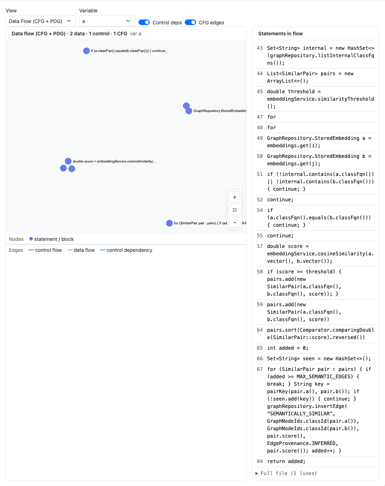
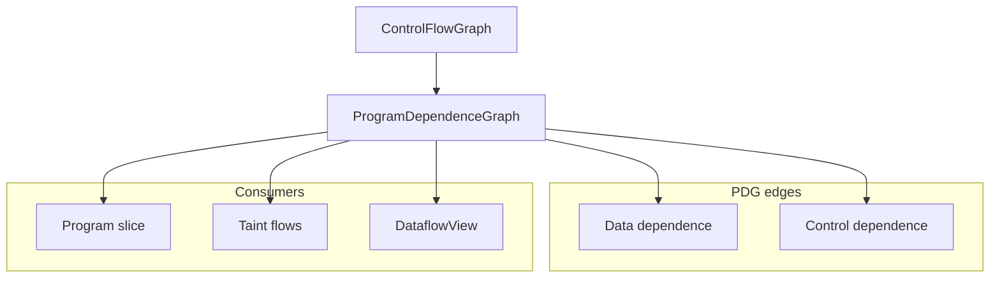

# Program Dependence Graph (PDG) — Engineering Design

**Program dependence graph** — data and control dependencies between statements within a function. Foundation for slicing, taint, and dataflow visualization.



*Figure 1: **Dataflow** tab in PDG mode — variable selector, control/data edge toggles, and Sigma PDG layout.*

---

## 1. Goals

| Goal | How |
|------|-----|
| Statement-level deps | Data edges (def-use) + control edges |
| Slice foundation | Backward/forward slice = graph reachability |
| Interactive exploration | Dashboard variable filter + statement list |
| CLI export | `inspect SYMBOL pdg` with `--edge-layer data|control` |

---

## 2. Architecture overview



PDG is built after CFG dominator analysis (`crates/rgctl-analysis/src/pdg.rs`). Reaching definitions (`dataflow.rs`) key defs by lexical **`(name, scope_id)`** so nested block shadowing does not create false data edges, while still modeling `let x = x + 1` (RHS before LHS).

Records live in the v3 indexed `.rgctl/analysis/cfg_pdg.archive.bin` (`CfgPdgArchiveMmap`). `rgctl slice` / `rgctl cpg flows` call `ensure_cfg_pdg_for_source` to build and append a single function’s CFG/PDG when the archive entry is missing — **no upfront `discover --with-cfg` required** for those verbs. Whole-repo `rgctl taint --sink` and `rgctl cpg mutations` still need `discover --with-cfg`.

### Opt-in fidelity (hybrid CPG P3)

| Flag / option | Effect |
|---------------|--------|
| `discover --with-dfg-loops` | Sets `PdgBuildOptions::classify_loop_carried` — tags `DataDependency.loop_carried` when the use block can reach the def block on the CFG (loop-carried) |
| `cpg flows --with-alias` / `slice --with-alias` | On-demand may-alias expansion (`alias::may_alias_names`) for copies + field bases; does not rewrite the PDG archive |

Default `discover --with-cfg` leaves `loop_carried = false` on all edges.

---

## 3. Dashboard dataflow mode

| Control | Effect |
|---------|--------|
| Variable dropdown | Highlight def-use neighborhood for one name |
| Include control | Add control-dependence edges |
| Include CFG overlay | Superimpose block structure |
| Statement list | Click row ↔ graph node |

Exported via `dataflow_index.json` + shared `slice/{id}.json` PDG payloads.

---

## 4. Rust implementation map

| Component | Path |
|-----------|------|
| PDG construction | `crates/rgctl-analysis/src/pdg.rs` |
| Reaching defs | `crates/rgctl-analysis/src/dataflow.rs` (`(name, scope_id)`) |
| Dominators (input) | `crates/rgctl-analysis/src/dominance.rs` |
| Archive / lazy append | `crates/rgctl-analysis/src/cfg_pdg_archive.rs` |
| Slicing | `crates/rgctl-analysis/src/slicing.rs` |
| CLI | `src/cli/inspect.rs`, `src/cli/slice.rs` |
| Dashboard engine | `dashboard/src/dataflowEngine.ts` |

---

## 5. Dashboard implementation

| Piece | Path |
|-------|------|
| Tab | `dashboard/src/DataflowView.tsx` |
| View mode | `dataflow` (PDG) vs `dominator` (see [dominance design](dominance-design.md)) |
| Legends | `PDG_NODE_LEGEND`, `PDG_EDGE_LEGEND` in `viewLegendData.ts` |
| Worker | `loadCfgDetail` + bundle PDG from `slice/` |

---

## 6. CLI usage

```bash
# Optional whole-repo prebuild
rgctl discover . --with-cfg

rgctl inspect process pdg --edge-layer data
rgctl inspect process pdg --def-use
rgctl -f mermaid inspect process pdg

# Lazy single-function CFG/PDG if archive entry missing; --function optional (innermost enclosing)
rgctl slice src/Foo.java --line 42 --variable x
rgctl slice src/Foo.java --line 42 --variable x --with-alias
rgctl -f json cpg flows --file src/Foo.java --line 42 --variable x --direction forward
```

---

## 7. Testing

| Layer | Location |
|-------|----------|
| PDG unit tests | `crates/rgctl-analysis/src/pdg.rs` |
| Dataflow export | `tests/dashboard_harness.rs` (`dataflow_index.json`) |

Screenshots: `capture-design-screenshots.mjs` → `docs/images/design/pdg/`.

---

## 8. Related docs

- [CFG design](cfg-design.md) · [Program slicing design](program-slicing-design.md)
- [Analysis architecture](../analysis-architecture.md)
