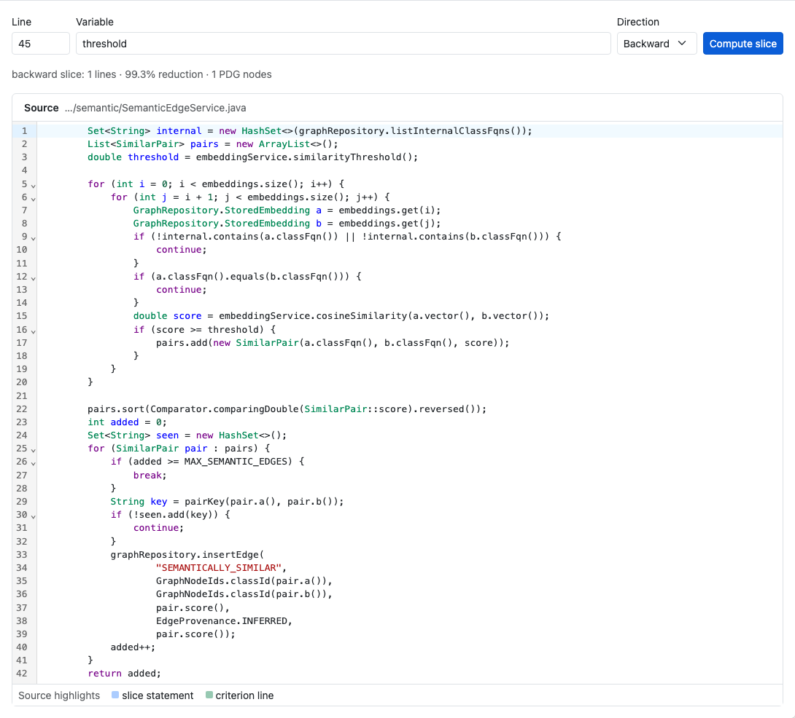
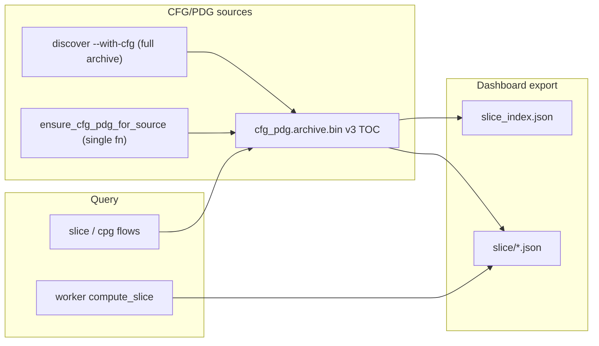

# Program Slicing — Engineering Design

**Backward and forward program slices** over a function’s PDG: the minimal set of statements that affect (or are affected by) a variable at a given source line.



*Figure 1: **Program Slicing** tab — function picker, line/variable/direction inputs, and CodeMirror source view with highlighted slice lines.*

---

## 1. Goals

| Goal | How |
|------|-----|
| Minimal relevant code | PDG traversal from slice criterion |
| CLI automation | `rgctl slice FILE --line N --variable V` |
| Dashboard exploration | WASM `compute_slice` on exported PDG bundles |
| Security cross-check | `--taint` mode shares taint engine paths |
| Lazy archive fill | `ensure_cfg_pdg_for_source` when the function is missing from v3 `cfg_pdg.archive.bin` |

**No upfront `discover --with-cfg` required for `rgctl slice`:** if the target function is absent from `.rgctl/analysis/cfg_pdg.archive.bin`, slice builds that function’s CFG/PDG (lexical `(name, scope_id)` reaching defs) and atomically appends its `TocEntry`. Whole-repo `rgctl taint --sink` and `rgctl cpg mutations` still require `discover --with-cfg`. Dashboard export of slice bundles still benefits from a prior `--with-cfg` / `--with-taint` discover.

---

## 2. Architecture overview



---

## 3. Slice criterion

| Field | Role |
|-------|------|
| `file` | Source path (read from disk at CLI; bundled in dashboard) |
| `--line` | 1-based line number |
| `--variable` | Variable name at criterion |
| `--function` | Optional enclosing **method** name; when omitted, innermost enclosing function at `file:line` is resolved |
| `--direction` | `backward` (default) or `forward` |
| `--with-alias` | Expand criterion via may-alias (copies / field bases) |
| `--taint` | Taint-aware slice path |

---

## 4. Rust implementation map

| Component | Path |
|-----------|------|
| CFG construction | `crates/rgctl-analysis/src/cfg.rs` |
| PDG + slicing | `crates/rgctl-analysis/src/pdg.rs`, `slicing.rs`, `dataflow.rs` |
| Lazy archive append | `crates/rgctl-analysis/src/cfg_pdg_archive.rs` (`ensure_cfg_pdg_for_source`) |
| CLI | `src/cli/slice.rs` |
| Dashboard export | `crates/rgctl-dashboard/src/slice_export.rs` |

---

## 5. Dashboard implementation

| Piece | Path |
|-------|------|
| Tab | `dashboard/src/SliceView.tsx` |
| Editor | `dashboard/src/sliceEditor.tsx` (CodeMirror) |
| Worker | `computeSlice(functionId, line, variable, direction)` |
| Index | `slice_index.json` → `slice/{uuid}.json` |

---

## 6. CLI usage

```bash
# No discover --with-cfg required — lazy single-function append into cfg_pdg.archive.bin
rgctl slice src/Foo.java --line 42 --variable cart
rgctl slice src/Foo.java --line 42 --variable cart --function checkOut
rgctl -f json slice src/Foo.java --line 10 --variable req --direction forward
rgctl slice src/Foo.java --line 8 --variable input --with-alias
rgctl slice src/Foo.java --line 8 --variable input --taint

# Optional whole-repo prebuild for dashboard / taint --sink / cpg mutations
rgctl discover . --with-cfg --with-taint
```

---

## 7. Testing

| Layer | Location |
|-------|----------|
| Analysis unit tests | `crates/rgctl-analysis/src/slicing.rs` |
| CLI subprocess | `tests/cli_output/all_commands_sanity.rs` |
| Dashboard harness | `tests/dashboard_harness.rs` (`slice_index.json`) |

Screenshots: `capture-design-screenshots.mjs` → `docs/images/design/program-slicing/`.

---

## 8. Related docs

- [PDG design](pdg-design.md) · [Taint design](taint-analysis-design.md)
- [Analysis architecture](../analysis-architecture.md)
