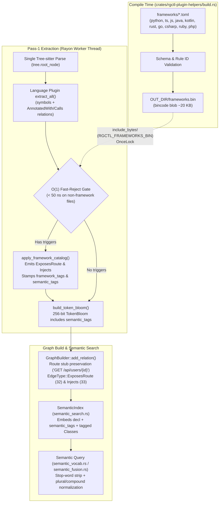

# Dependency Injection and Frameworks

## Introduction

In modern applications, control flow and service wiring are often declared through framework annotations, decorators, type extractors, and Dependency Injection (DI) containers rather than explicit function calls. During `discover`, rgctl automatically runs a compiled **Framework & DI extraction pass** — build-time **`frameworks.bin` (`RBFW` v2)** catalog covering Spring, JAX-RS, Quarkus, Micronaut, FastAPI, Flask, Django, Express, NestJS, Next.js, Gin, Echo, Actix, Axum, Rails, Laravel, ASP.NET Core, and more — that turns these declarative patterns into first-class graph edges (`ExposesRoute`, `Injects`, `Provides`, `WiredBy`) and enriches matched symbols with semantic vocabulary tags (`framework_tags` and `semantic_tags`).

You can then inspect HTTP/RPC endpoints and DI dependencies deterministically with `relations`, `find`, and `inventory`, or search for architectural roles in plain English with `semantic query` (e.g., *"hey give me all my end points"*, *"give me all my controllers"*, or *"give me all my reflection classes"*).

> **Audience guide:**
> - **Users & Agents:** Follow **[Use Cases](#use-cases)** through **[Benefits](#benefits)** for step-by-step CLI workflows on **CoolStore**.
> - **Developers & Contributors:** Jump to **[Developer & Contributor Reference](#developer--contributor-reference)** for the compiled `frameworks.bin` architecture, TOML rule primitives, vocabulary embedding pipeline, and contributor checklist.

## Use Cases

- **Map API attack and entry surfaces.** List every exposed HTTP/RPC route (`GET /cart/{cartId}`, `POST /api/orders`) and the exact handler function that serves it.
- **Trace Dependency Injection wiring.** See which services, repositories, or state extractors a controller or handler injects (`Injects` edges) in either direction without grepping for `@Autowired`, `@Inject`, `Depends(...)`, or `State<T>`.
- **Natural-language architectural discovery.** Ask `semantic query` for *"all my end points"*, *"all my controllers"*, or *"all my reflection classes"* even when symbol names do not contain the words `endpoint`, `controller`, or `reflection`.
- **Extend rules without recompiling.** Drop a `.toml` file into `.rgctl/frameworks.d/` to teach rgctl about internal company frameworks or custom decorators.
- **Migration & blast-radius completeness.** Include `ExposesRoute` and `Injects` edges in centrality and service boundary analysis when decomposing monoliths.

## Example Project

This guide uses **CoolStore** (`example/coolstore`). Make sure you have run `discover` first:

CoolStore examples use `-l java` to index the Java backend only (skip Angular/bower).

```bash
rgctl -r example/coolstore discover -l java
```

---

## Step-by-Step (User & Agent Guide)

### 1. Inspect Route & DI Counts in Inventory

Check how many `exposesroute` and `injects` relationships were extracted across the repository:

```bash
rgctl -r example/coolstore -f json inventory --by edge | jq '.counts[] | select(.key=="exposesroute" or .key=="injects")'
```

**Output:**

```json
{
  "count": 6,
  "key": "exposesroute",
  "occurrences": 6
}
{
  "count": 8,
  "key": "injects",
  "occurrences": 8
}
```

**What this tells you:**

- **`exposesroute`** -- 6 distinct HTTP route endpoints are exposed by REST controller methods in CoolStore.
- **`injects`** -- 8 dependency injection edges connect classes/constructors/fields to their injected service providers.

### 2. List All Exposed HTTP Endpoints (`exposesroute`)

Use `relations --edge exposesroute` (lowercase CLI token) to list every route handler and the canonical HTTP verb + path it exposes:

```bash
rgctl -r example/coolstore -f json relations --edge exposesroute --limit 10
```

**Output (top edges):**

```json
{
  "edges": [
    {
      "direction": "out",
      "edge": "exposesroute",
      "hops": 1,
      "occurrences": 1,
      "source": {
        "file": "src/main/java/com/redhat/coolstore/rest/CartEndpoint.java",
        "id": "67a58a6b-70c4-52bd-a398-95da64a4d575",
        "line": 62,
        "name": "checkout",
        "qualified_name": "com.redhat.coolstore.rest.CartEndpoint.checkout",
        "type": "function"
      },
      "target": {
        "file": "<external>",
        "id": "9a1c4e20-31b4-5e11-8c90-12a4f09d81b2",
        "name": "POST /cart/checkout/{cartId}",
        "qualified_name": "route::POST /cart/checkout/{cartId}",
        "type": "function"
      }
    },
    {
      "direction": "out",
      "edge": "exposesroute",
      "hops": 1,
      "occurrences": 1,
      "source": {
        "file": "src/main/java/com/redhat/coolstore/rest/CartEndpoint.java",
        "id": "e14b9012-44c1-508a-9d11-77bc01239a01",
        "line": 39,
        "name": "getCart",
        "qualified_name": "com.redhat.coolstore.rest.CartEndpoint.getCart",
        "type": "function"
      },
      "target": {
        "file": "<external>",
        "id": "4b8812d0-19a0-5c33-a811-00912bc8172f",
        "name": "GET /cart/{cartId}",
        "qualified_name": "route::GET /cart/{cartId}",
        "type": "function"
      }
    }
  ],
  "returned": 2,
  "schema_version": 2,
  "target": null,
  "total": 6
}
```

**What this tells you:**

- **`source`** -- the handler method (`CartEndpoint.checkout`, `CartEndpoint.getCart`) with its exact file path and line number.
- **`target`** -- the normalized route node (`POST /cart/checkout/{cartId}`), built by combining the class-level `@Path("/cart")` prefix with the method-level `@POST` and `@Path("/checkout/{cartId}")` annotations.

### 3. Trace Dependency Injection Wiring (`injects`)

Find all services injected into `CartEndpoint` (`--direction out`), or find every class that injects `ShoppingCartService` (`--direction in`):

```bash
# What does CartEndpoint inject?
rgctl -r example/coolstore -f json relations CartEndpoint --edge injects --direction out
```

**Output:**

```json
{
  "edges": [
    {
      "direction": "out",
      "edge": "injects",
      "hops": 1,
      "occurrences": 1,
      "source": {
        "file": "src/main/java/com/redhat/coolstore/rest/CartEndpoint.java",
        "id": "2c91a044-812b-5d90-b112-4489012abc01",
        "line": 23,
        "name": "CartEndpoint",
        "qualified_name": "com.redhat.coolstore.rest.CartEndpoint",
        "type": "class"
      },
      "target": {
        "file": "src/main/java/com/redhat/coolstore/service/ShoppingCartService.java",
        "id": "8f012b33-901a-5c44-8210-99123abcd456",
        "line": 22,
        "name": "ShoppingCartService",
        "qualified_name": "com.redhat.coolstore.service.ShoppingCartService",
        "type": "class"
      }
    }
  ],
  "returned": 1,
  "schema_version": 2,
  "target": {
    "file": "src/main/java/com/redhat/coolstore/rest/CartEndpoint.java",
    "id": "2c91a044-812b-5d90-b112-4489012abc01",
    "line": 23,
    "name": "CartEndpoint",
    "qualified_name": "com.redhat.coolstore.rest.CartEndpoint",
    "type": "class"
  },
  "total": 1
}
```

Reverse the direction to find all consumers of `ShoppingCartService`:

```bash
rgctl -r example/coolstore -f json relations ShoppingCartService --edge injects --direction in
```

### 4. Query Endpoints, Controllers & Reflection with Natural Language (`semantic`)

Build the semantic index, then query in plain English:

```bash
rgctl -r example/coolstore semantic index
rgctl -r example/coolstore -f json semantic query "hey give me all my end points" --limit 5
```

**Output:**

```json
{
  "dimensions": 256,
  "hits": [
    {
      "distance": 78,
      "file_path": "src/main/java/com/redhat/coolstore/rest/CartEndpoint.java",
      "fused_score": 0.684,
      "name": "checkout",
      "node_id": "67a58a6b-70c4-5a22-b9f4-4ccd10a3391e",
      "qualified_name": "com.redhat.coolstore.rest.CartEndpoint.checkout",
      "ranking": "fusion",
      "score": 0.695
    },
    {
      "distance": 82,
      "file_path": "src/main/java/com/redhat/coolstore/rest/CartEndpoint.java",
      "fused_score": 0.661,
      "name": "getCart",
      "node_id": "e14b9012-44c1-508a-9d11-77bc01239a01",
      "qualified_name": "com.redhat.coolstore.rest.CartEndpoint.getCart",
      "ranking": "fusion",
      "score": 0.680
    }
  ],
  "index_schema_version": 2,
  "model_id": "vocab-accumulate-v2",
  "query": "hey give me all my end points",
  "schema_version": 3
}
```

You can run the same style of query for other architectural concepts:

```bash
# Find all REST / web controllers
rgctl -r example/coolstore -f json semantic query "give me all my controllers" --limit 10

# Find classes and functions using dynamic reflection
rgctl -r example/coolstore -f json semantic query "give me all my reflection classes" --limit 10

# Find injected service providers
rgctl -r example/coolstore -f json semantic query "dependency injection services" --limit 10
```

**What happened:**

- During `discover`, the compiled framework catalog matched `@Path`, `@GET`, `@POST`, and `@Inject` and stamped `semantic_tags` (`"endpoint endpoints route routes http rest api handler"`, `"controller controllers..."`) onto the corresponding symbols and their 256-bit `TokenBloom` sketches.
- During `semantic query`, rgctl stripped conversational filler words (`"hey"`, `"give"`, `"me"`, `"all"`, `"my"`), canonicalized `"end points"` → `"endpoint endpoints"`, and ranked the route handlers at the top via Hamming similarity + late fusion.

### 5. Add Repo-Local Custom Framework Rules (`.rgctl/frameworks.d/`)

If your codebase uses an in-house framework or custom decorators, add a `.toml` file under `.rgctl/frameworks.d/` without recompiling rgctl:

```bash
mkdir -p .rgctl/frameworks.d
cat > .rgctl/frameworks.d/custom_rpc.toml <<'EOF'
language = "python"

[[rules]]
id = "acme.rpc.endpoint"
framework = "acme-rpc"
kind = "route_decorator"
method_annotations = [
  { name = "rpc_endpoint", default_method = "POST" },
]
tags = ["role:endpoint", "protocol:rpc"]
vocab = "endpoint endpoints route routes rpc api handler internal"

[[rules]]
id = "acme.di.provide"
framework = "acme-di"
kind = "param_call_inject"
provider_calls = ["Provide", "InjectClient"]
tags = ["role:di-consumer"]
vocab = "dependency injection injected provider client service"
EOF
```

On the next `rgctl discover`, rgctl hashes `.rgctl/frameworks.d/*.toml` with BLAKE3, compiles and caches the merged catalog to `.rgctl/cache/frameworks.bin`, and extracts your custom routes and DI edges automatically.

## Understanding Results

| Edge / Property | Source Node | Target Node | Meaning |
|-----------------|-------------|-------------|---------|
| `exposesroute` (`EdgeType::ExposesRoute`) | Handler `Function` | Route `Function` (`route::<VERB> <path>`) | Handler exposes an HTTP/RPC route |
| `injects` (`EdgeType::Injects`) | Consumer `Class` or `Function` | Provider `Class`, `Struct`, `Interface`, or `Function` | Consumer injects a dependency via field, constructor, wrapper, or parameter call |
| `framework_tags` (node property) | `Class` / `Function` | — | Comma-separated structured tags (`role:endpoint`, `role:controller`, `role:service`, `role:di-consumer`, `role:reflection`) |
| `semantic_tags` (node property) | `Class` / `Function` | — | Space-separated vocabulary tokens indexed by `TokenBloom` and `semantic_index.bin` |

### Supported Frameworks Matrix

| Language | HTTP / Route Frameworks (`ExposesRoute`) | Dependency Injection (`Injects`) | Stereotypes & Reflection (`concept_tagger`) |
|----------|------------------------------------------|----------------------------------|---------------------------------------------|
| **Python** | FastAPI (`@app.get`, `@router.post`), Flask (`@app.route`, `add_url_rule`), Django (`path`, `re_path`), Litestar | FastAPI `Depends(...)`, `Security(...)` (`Annotated[T, Depends(...)]`) | `getattr`, `setattr`, `import_module`, `__subclasses__` |
| **TypeScript / JS** | NestJS (`@Controller` + `@Get`/`@Post`/…), Express / Fastify / Hono (`app.get("/...", handler)`) | NestJS / Angular `@Injectable()`, `@Controller()` constructor DI, `@Inject(TOKEN)` | `@Controller`, `@Injectable`, `Reflect.getMetadata`, `Reflect.defineMetadata` |
| **Java / Kotlin** | Spring Web (`@RequestMapping`, `@GetMapping`, `@PostMapping`, …), JAX-RS / Quarkus / Micronaut (`@Path`, `@GET`, `@POST`, `@Controller`) | Spring / Jakarta / Micronaut / Dagger (`@Autowired`, `@Inject`, `@Resource`, `@Value`, implicit constructor DI on `@Service`/`@RestController`/`@Component`/`@Repository`) | `@RestController`, `@Controller`, `@Service`, `@Repository`, `Class.forName`, `getDeclaredMethod`, `Method.invoke` |
| **Rust** | Axum (`.route("/...", get(handler))`), Actix-Web / Rocket (`#[get("/...")]`, `#[post("/...")]`, `#[route(...)]`) | Axum `State<T>`, `Extension<T>`; Actix `web::Data<T>` (unwrapping `Arc<T>`) | `std::any::Any`, `TypeId::of`, `downcast_ref` |
| **Go** | Gin / Echo / Chi / Fiber (`r.GET`, `e.POST`, `mux.HandleFunc`) | Uber Fx / Google Wire (`fx.Invoke`, `fx.Provide`, `wire.Build`) | `reflect.TypeOf`, `reflect.ValueOf`, `MethodByName` |
| **C#** | ASP.NET Core (`[Route]`, `[HttpGet]`, `[HttpPost]`, `MapGet`, `MapPost`) | `[FromServices]`, constructor DI on `[ApiController]` | `[ApiController]`, `System.Reflection`, `Activator.CreateInstance` |
| **Ruby** | Rails (`resources`, `get`, `post`, `put`, `delete`) | Dry-AutoInject (`Import[...]`) | `ActionController`, `send`, `public_send`, `const_get` |
| **PHP** | Laravel / Symfony (`Route::get`, `Route::post`, `#[Route(...)]`) | Constructor type-hint DI, `#[Autowire]` | `ReflectionClass`, `ReflectionMethod` |

---

## Developer & Contributor Reference

This section documents the internal design of the declarative framework catalog and vocabulary enrichment pipeline for rgctl contributors.

### 1. Architecture Overview

Rather than hardcoding framework-specific visitor branches inside 20+ language plugins, rgctl compiles declarative `frameworks/<lang>.toml` files into an embedded **`frameworks.bin` (`RBFW` v2)** catalog at build time (`OUT_DIR/frameworks.bin`) — the same pattern used by `vocab_matrix.bin` in `rgctl-analysis`. Repo-local overlays merge into `.rgctl/cache/frameworks.bin`.



- **Zero second Tree-sitter parse:** `apply_framework_catalog(lang_id, source, Some(tree.root_node()), &mut symbols, &mut relations)` runs at the end of `extract_all` while `tree` is still in memory.
- **`O(1)` fast-reject gate (`< 0.15%` cold-discover overhead):** On files without matching `AnnotatedWith` relations, `Calls`, or parameter wrappers, `apply_framework_catalog` returns in `< 50 ns` with zero AST traversal.
- **Full `FactsCache` compatibility:** Because `ExposesRoute`, `Injects`, `framework_tags`, and `semantic_tags` are attached to `Symbol` and `Relation` records inside `extract_all`, incremental `rgctl update` and `rgctl watch` persist and replay them automatically via `.rgctl/facts.bin`.

### 2. The 7 Declarative Rule Primitives (`FrameworkRuleKind`)

| `kind` | What It Matches | Edge Emitted | Example Triggers |
|--------|-----------------|--------------|------------------|
| `route_decorator` | Class prefix annotations (`class_prefix_annotations`) + method HTTP verb annotations (`method_annotations`) | `ExposesRoute` (`handler -> "VERB /full/path"`) | `@RequestMapping` + `@GetMapping`, `@Controller` + `@Get`, `@app.get`, `#[get("/...")]`, `[HttpGet]` |
| `route_call` | Programmatic router registration calls (`router_callees`) | `ExposesRoute` (`handler -> "VERB /path"`) | `app.get("/...", h)`, `.route("/...", get(h))`, `path("p/", v)`, `r.GET("/...", h)`, `Route::get` |
| `field_annotation_inject` | Fields/properties with `AnnotatedWith` in `annotations` | `Injects` (`EnclosingClass -> FieldType`) | `@Autowired`, `@Inject`, `@Resource`, `@Value` |
| `ctor_or_stereotype_inject` | Constructors/setters with `annotations` OR constructors on classes with stereotype annotations | `Injects` (`Class -> ParamType`) | `@Autowired`, `@Inject`, `@Service`, `@RestController`, `@Component`, `@Repository`, `@Injectable`, `[ApiController]` |
| `param_wrapper_inject` | Generic parameter wrapper types (`wrapper_types`), unwrapping inner `Arc<T>` / `RwLock<T>` | `Injects` (`Function -> InnerTypeT`) | `State<T>`, `Extension<T>`, `Data<T>`, `[FromServices] T` |
| `param_call_inject` | Default-value or `Annotated[T, ...]` provider calls in parameters (`provider_calls`) | `Injects` (`Function -> ProviderFn`) | `Depends(get_db)`, `Security(verify_jwt)`, `inject(Service)` |
| `concept_tagger` | Matches `annotations` or `call_callees` on a `Class`/`Struct`/`Interface`/`Function` | *(None — stamps `framework_tags` & `semantic_tags`)* | `@RestController`, `@Service`, `Class.forName`, `getDeclaredMethod`, `reflect.TypeOf`, `getattr` |

### 3. TOML Rule Schema Example

```toml
# crates/rgctl-plugin-helpers/frameworks/java.toml
language = "java"

[[rules]]
id = "spring.jaxrs.http.routes"
framework = "spring"
kind = "route_decorator"
class_prefix_annotations = ["RequestMapping", "Path"]
method_annotations = [
  { name = "GetMapping", method = "GET" },
  { name = "PostMapping", method = "POST" },
  { name = "PutMapping", method = "PUT" },
  { name = "DeleteMapping", method = "DELETE" },
  { name = "PatchMapping", method = "PATCH" },
  { name = "RequestMapping", method_arg = "method", default_method = "ANY" },
  { name = "GET", method = "GET" },
  { name = "POST", method = "POST" },
]
tags = ["role:endpoint", "protocol:http"]
vocab = "endpoint endpoints route routes http rest api handler controller action"

[[rules]]
id = "jvm.reflection"
framework = "jvm-reflect"
kind = "concept_tagger"
call_callees = ["forName", "getDeclaredMethod", "getDeclaredField", "getMethod", "newInstance", "invoke"]
annotations = ["ReflectiveAccess", "RegisterForReflection"]
tags = ["role:reflection", "dynamic:dispatch"]
vocab = "reflection reflect reflective dynamic class loading introspection invoke method metadata"
```

### 4. Rust Implementation Map

| Component | Path |
|-----------|------|
| Shared rule schema | `crates/rgctl-plugin-helpers/src/framework_schema.rs` |
| Compile-time TOML → `frameworks.bin` | `crates/rgctl-plugin-helpers/build.rs` |
| Built-in language catalogs | `crates/rgctl-plugin-helpers/frameworks/*.toml` |
| Runtime `OnceLock` catalog & matcher | `crates/rgctl-plugin-helpers/src/framework.rs` |
| `RelationType::{ExposesRoute, Injects}` | `crates/rgctl-plugin-api/src/lib.rs` |
| `EdgeType::{ExposesRoute, Injects}` & CSR codes (`32`, `33`) | `crates/rgctl-graph/src/schema.rs`, `crates/rgctl-graph/src/csr.rs` |
| Route stub preservation & `TokenBloom` | `crates/rgctl-extraction/src/graph_builder.rs`, `crates/rgctl-extraction/src/extractor.rs` |
| Vocab token list & query normalization | `crates/rgctl-analysis/assets/vocab_tokens.txt`, `crates/rgctl-analysis/src/semantic_vocab.rs` |
| Tagged class indexing & late fusion | `crates/rgctl-analysis/src/semantic_search.rs`, `crates/rgctl-analysis/src/semantic_fusion.rs` |

### 5. Adding a New Framework Rule (Contributor Checklist)

1. **Edit `crates/rgctl-plugin-helpers/frameworks/<lang>.toml`**: Add a `[[rules]]` entry with a globally unique `id`, `framework`, `kind`, trigger list, `tags`, and `vocab` (include both singular and plural forms in `vocab`).
2. **Verify `crates/rgctl-analysis/assets/vocab_tokens.txt`**: Ensure all domain words used in `vocab` (`3..=48` chars, lowercase ASCII) appear in `vocab_tokens.txt` in sorted order.
3. **Wire new language plugin (if applicable)**: Call `rgctl_plugin_helpers::apply_framework_catalog("<lang>", source, Some(tree.root_node()), &mut symbols, &mut relations)` at the end of `extract_all`.
4. **Run tests**:
   ```bash
   cargo test -p rgctl-plugin-helpers -p rgctl-extraction -p rgctl-analysis
   ```

## Benefits

- **Declarative & zero-boilerplate.** Adding a new framework or DI pattern is a 10-line TOML entry compiled into `frameworks.bin` rather than custom Rust AST code.
- **Zero cold-path regression.** Embedded `bincode` catalog + `O(1)` fast-reject precheck keeps `discover` overhead under `0.15%`.
- **Bridges structural and semantic search.** Every matched rule produces both exact graph edges (`exposesroute`, `injects`) and vocabulary tokens (`semantic_tags`) for natural-language search.
- **User-extensible offline.** Teams can add repo-local `.rgctl/frameworks.d/*.toml` rules without rebuilding rgctl or running external daemons.

## Related Guides

- [Discovering and Indexing a Codebase](discovering-and-indexing.md) -- must run `discover` first
- [Structured graph queries](structured-query.md) -- `find`, `callers`, `relations`, and `inventory`
- [Semantic Search](semantic-search.md) -- natural-language search over indexed symbols
- [Blast Radius Analysis](blast-radius-analysis.md) -- upstream impact analysis across callers
- [Migration Planning](migration-planning.md) -- service boundary and decoupling analysis
